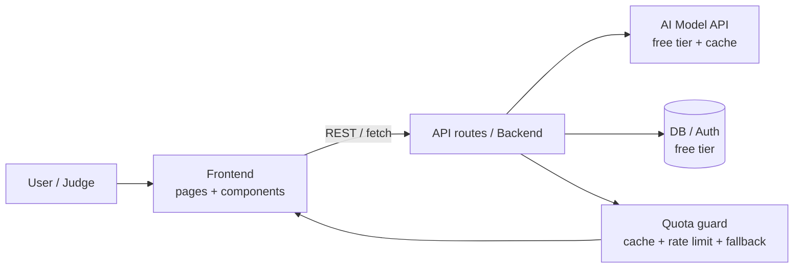

# 15 — Library / Tool Packet for Judging Packet + Video

**Goal:** Ship a complete, quota-proof judging packet: README, ARCHITECTURE (mermaid), benchmarks, 60–90s video + captions, PPT outline. Minimal deps, free tiers, no watermark traps.

## 1. Recommended Stack (free, no-credit-card)

| Need | Pick | Why | Alternative |
|---|---|---|---|
| README template | GitHub README + shields.io + mermaid | Judges read this first; renders everywhere | Notion public page (mirror only) |
| Architecture diagram | Mermaid (in-markdown) + Excalidraw (PNG fallback) | Versionable, no login, embeds in GitHub | diagrams.net / draw.io |
| Benchmarks table | Markdown table + `benchmark/` scripts (Node `perf_hooks` / Python `timeit`) | Reproducible, quota-proof | Google Sheets link as mirror |
| Quota-proof evidence | `quota-proof/` folder: screenshots + `LIMITS.md` + free-tier docs links | Proves it runs on free tier | Loom status page screenshot |
| 60–90s video script | Markdown script + teleprompter (Teleprompter.com free) | Keeps you on time | Google Docs voice typing |
| Captions | YouTube auto-captions → export `.srt` + CapCut auto-captions | Accessibility = judging points | Clipchamp (Win free) |
| Video edit | CapCut Desktop (free, no watermark) / Clipchamp | Fast, templates, 1080p free export | DaVinci Resolve (heavier) |
| Screen record | OBS Studio (free, no watermark) | 1080p60, selective capture | Xbox Game Bar (`Win+G`) quick capture |
| PPT / pitch deck | Canva (Hackathon Pitch template) / Google Slides + `pitch-outline.md` | Fast, collaborative | Marp (Markdown → PPTX, fully offline) |
| PDF export | GitHub print-to-PDF / Google Slides → PDF | Submission-safe | Pandoc `md → pdf` |

**Install (Windows):** `winget install OBSProject.OBSStudio CapCut Clipchamp` — Marp: `npm i -g @marp-team/marp-cli` — Pandoc: `winget install Pandoc.Pandoc`.

## 2. File List (create under `submission/`)

```
submission/
├── README.md               # judging entry point (template §3)
├── ARCHITECTURE.md         # mermaid + PNG fallback (§4)
├── BENCHMARKS.md           # table + repro steps (§5)
├── LIMITS.md               # quota-proof: tiers, caps, cost=₹0 (§6)
├── PITCH.md                # 60–90s script + shot list + captions workflow (§7)
├── captions/
│   └── demo.srt            # exported captions
├── assets/
│   ├── arch.png            # Excalidraw/draw.io export (fallback if mermaid fails in PDF)
│   ├── demo-thumb.png      # 1280×720 thumbnail
│   └── quota-proof/        # screenshots: dashboard usage, build logs, billing=₹0
├── deck/
│   └── outline.md          # 8-slide PPT outline (§8) → build in Canva/Slides
└── benchmark/
    └── run.js              # minimal repro timing script
```

## 3. README Template (copy-paste)

```markdown
# <Project Name> — One-line value prop


> 30-sec pitch: problem → solution → who it helps.

## Demo (2 links max)
- 🎥 Video (60–90s): <youtube/unlisted link>
- 🚀 Live: <deployed URL> | 📦 Repo: <github URL>

## What it does (bullets, ≤6)
- ...
## How it works (3 steps + diagram link)
1. ... → 2. ... → 3. ...
See [ARCHITECTURE.md](./ARCHITECTURE.md).
## Tech stack table
| Layer | Choice | Why |
|---|---|---|
| Frontend |  |  |
| Backend/AI |  |  |
| DB/Auth/Deploy |  |  |
## Run locally (≤5 cmds, tested on fresh clone)
\`\`\`bash
git clone <repo> && cd <repo>
npm install
cp .env.example .env   # fill keys
npm run dev
\`\`\`
## Benchmarks → [BENCHMARKS.md](./BENCHMARKS.md) | Quota-proof → [LIMITS.md](./LIMITS.md)
## Team + roles | License (MIT)
```

## 4. ARCHITECTURE Diagram (mermaid — paste into ARCHITECTURE.md)



Add underneath: **Data flow (5 lines)** + **Failure fallback (2 lines, e.g., cache → canned response)** + PNG fallback in `assets/arch.png` (Excalidraw → export 2x).

## 5. Benchmarks Table (BENCHMARKS.md)

```markdown
## Setup
Device: <laptop/CPU/RAM> | Network: <Mbps> | Date: <YYYY-MM-DD> | Commit: <sha>

| Metric | Trial 1 | Trial 2 | Trial 3 | Median | Notes |
|---|---|---|---|---|---|
| Cold start (deploy) |  |  |  |  |  |
| p50 API latency |  |  |  |  | measured via benchmark/run.js |
| AI call latency (cached / fresh) | / | / | / | / | proves quota guard works |
| Lighthouse Perf / A11y | / |  |  |  | `npx lighthouse <url>` |
| Bundle / payload size |  |  |  |  |  |

## Repro
\`\`\`bash
node benchmark/run.js   # hits /api/health 20x, prints p50/p95
npx lighthouse <live-url> --view
\`\`\`
```

Minimal `benchmark/run.js`: loop `fetch`, collect `performance.now()` deltas, print median/p95. 20 lines max.

## 6. Quota-Proof (LIMITS.md — judges love this)

```markdown
## Free-tier budget (cost = ₹0)
| Service | Tier | Cap used | We use | Proof |
|---|---|---|---|---|
| Hosting | Vercel/Render free | 100GB bw / sleep | ~__ MB | assets/quota-proof/bandwidth.png |
| AI API | <provider> free | __ req/day | __ req/demo | dashboard screenshot |
| DB/Auth | Supabase/Firebase free | 500MB / 50k MAU | __ | usage.png |
## Guards
- Cache (TTL __) + debounce + server-side rate limit (__/min) + fallback message when quota hit.
- No keys in client; `.env.example` documents every var.
## If quota hits mid-demo → offline GIF + cached response path (see video 0:55).
```

## 7. 60–90s Video Script + Captions (PITCH.md)

**Structure (75s target):** 0:00–0:10 Hook (problem, 1 line) → 0:10–0:35 Demo (3 clicks, no typing) → 0:35–0:55 How it works (point at arch diagram, 20s) → 0:55–1:10 Quota/benchmark flex (1 number) → 1:10–1:15 CTA (live link + QR).

**Shot list:** 1) Face intro (5s) 2) Screen-record 1080p, zoom 150%, mic check 3) End card: links + QR (generated free via `qrencode` / Canva QR).

**Script template (read at ~140 wpm ≈ 175 words):**
> "Judges, [problem] wastes [X]. [Project] fixes it in 3 clicks. Watch — [click1], [click2], [result]. Under the hood: [FE] → [API] → [cached AI]. It answers in [N]s and costs zero — cached, rate-limited, quota-proof. Try it live at [URL]. Thank you."

**Captions workflow:** Edit in CapCut → Auto-captions → Export `.srt` to `captions/demo.srt` → Upload to YouTube unlisted → enable auto-translate. OBS settings: 1080p, 30fps, mic noise-suppress ON, record `.mkv` → remux to `.mp4`.

## 8. PPT Outline (deck/outline.md → 8 slides, 5-min pitch)

1. Title (name + tagline + QR) 2. Problem (1 stat + pain quote) 3. Solution (3 bullets + screenshot) 4. Demo (QR + 3 steps) 5. Architecture (mermaid PNG + 3-line flow) 6. Benchmarks + quota-proof (1 table + ₹0 badge) 7. Roadmap (Now/Next/Later, 3 items) 8. Team + Ask (roles + contact + repo link). Design: 1 idea/slide, 24pt+, dark-on-light, export PDF backup.

## 9. Build Checklist (night-before)

- [ ] README links live (video + deploy) — open in incognito
- [ ] ARCHITECTURE renders (GitHub + PDF export)
- [ ] Video ≤90s, captions present, voice audible on phone speaker
- [ ] `assets/quota-proof/` has ≥2 screenshots, LIMITS.md numbers match
- [ ] Fresh-clone run works (`npm install && npm run dev`)
- [ ] Deck PDF backup + QR scannable
